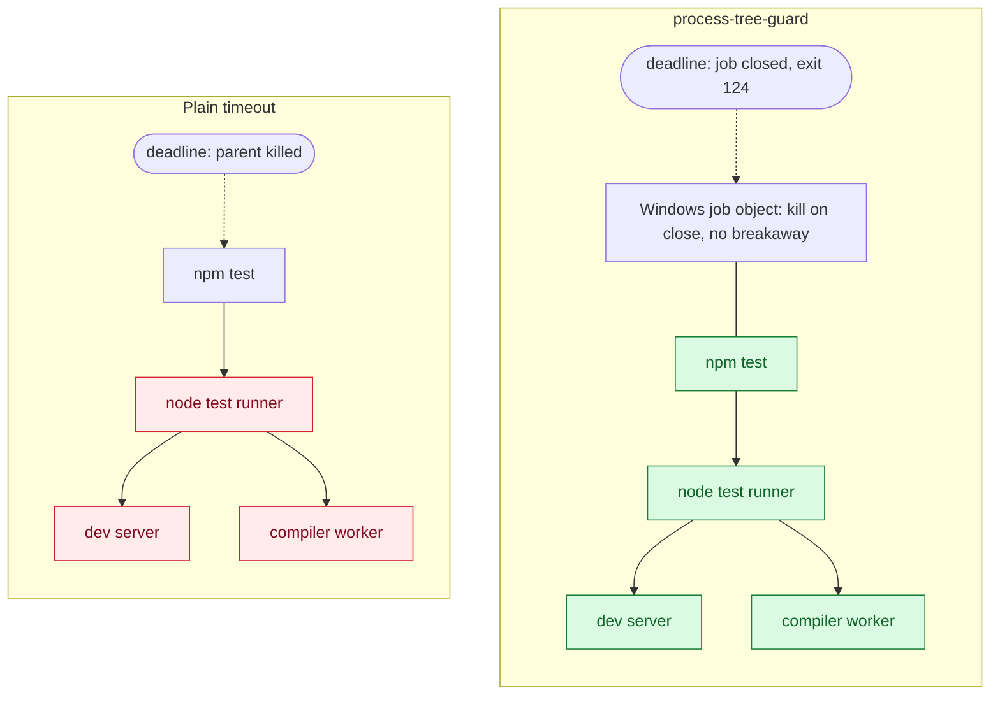

<!-- SPDX-License-Identifier: Apache-2.0 -->
<!-- Copyright 2026 Peter Shiller -->
https://github.com/user-attachments/assets/12ba45cd-4738-4d60-bd16-fb7294d9e57f

<p align="center">
<a href="https://github.com/WikdSolvemProbler/process-tree-guard/actions/workflows/ci.yml"></a>
<a href="https://github.com/WikdSolvemProbler/process-tree-guard/releases"></a>
<a href="LICENSE"></a>


</p>

<p align="center"><sub>Built at the Meta Global AI Developer Hackathon, sponsored by Cerebral Valley, Meta, Baseten, Fireworks AI and Modal. We thank them for their support.</sub></p>

<p align="center">
<a href="https://cerebralvalley.ai"><picture><source media="(prefers-color-scheme: dark)" srcset="assets/sponsors/cerebralvalley-dark.png"></picture></a>&nbsp;&nbsp;&nbsp;&nbsp;<a href="https://www.meta.com"><picture><source media="(prefers-color-scheme: dark)" srcset="assets/sponsors/meta-dark.svg"></picture></a>&nbsp;&nbsp;&nbsp;&nbsp;<a href="https://www.baseten.co"><picture><source media="(prefers-color-scheme: dark)" srcset="assets/sponsors/baseten-dark.png"></picture></a>&nbsp;&nbsp;&nbsp;&nbsp;<a href="https://fireworks.ai"><picture><source media="(prefers-color-scheme: dark)" srcset="assets/sponsors/fireworks-dark.svg"></picture></a>&nbsp;&nbsp;&nbsp;&nbsp;<a href="https://modal.com"><picture><source media="(prefers-color-scheme: dark)" srcset="assets/sponsors/modal-dark.svg"></picture></a>
</p>

<p align="center"><sub>The launch film, 3:33. <a href="https://github.com/WikdSolvemProbler/process-tree-guard/releases/download/v0.5.0/process-tree-guard-launch-1080p60.mp4">Download it in 1080p</a>.</sub></p>

**Every command ends on time, and nothing it started is left behind.**

process-tree-guard (ptg for short) runs one command under one finite, stated deadline on Windows. At the deadline, it ends the command and every process the command started. It is written in Rust, uses no third-party crates, and is licensed under Apache 2.0. Version 0.5.0 is the first public release.

```powershell
process-tree-guard --timeout 60 -- npm test
```

## Contents

- [The problem](#the-problem)
- [Quick start](#quick-start)
- [The exit code contract](#the-exit-code-contract)
- [Why a job object and not a plain timeout](#why-a-job-object-and-not-a-plain-timeout)
- [The four programs](#the-four-programs)
- [Hook integrations for coding agents](#hook-integrations-for-coding-agents)
- [Guarantees and limits](#guarantees-and-limits)
- [Guarantees and limits in detail](#guarantees-and-limits-in-detail)
- [Platform support](#platform-support)
- [Build from source](#build-from-source)
- [Results](#results)
- [Documentation](#documentation)
- [License](#license)

## The problem

Artificial intelligence (AI) coding agents, scripts and Continuous Integration (CI) jobs start processes all day.
Some of those processes never end.
A test run waits on a socket. A dev server stays in the background. A build tool leaves a compiler worker behind.
A plain timeout kills the process it started, and the children of that process keep running.
The result is a hung agent session, a stuck CI runner, a locked file or a port that stays busy.

process-tree-guard closes that gap.
The command is born inside a Windows job object.
Every process the command starts is born inside the same job.
At the deadline, the guard closes the job and Windows ends every process in it.

[↑ Back to Contents](#contents)

## Quick start

**1. Install.** One line in PowerShell installs the latest release for your machine (native x86-64; Windows on Arm64 uses the native build when the release has one, otherwise x86-64 under emulation), checks every file against the release checksums, sets up automatic mode and adds the programs to your PATH:

```powershell
irm https://raw.githubusercontent.com/WikdSolvemProbler/process-tree-guard/main/install.ps1 | iex
```

It also writes hook settings with your machine's paths for the coding agents it finds. To install by hand instead, download the x86-64 Windows release from the releases page of this repository. Check each program against the Secure Hash Algorithm 256 (SHA-256) list in `SHA256SUMS`:

```powershell
(Get-FileHash .\process-tree-guard.exe -Algorithm SHA256).Hash
```

Put the programs and `POLICY.md` in one of the two layouts on [Policy File and Layout](wiki/Policy-File-and-Layout.md). Or [build from source](#build-from-source). `ptg` is the short name of the full program: a copy of `process-tree-guard.exe` named `ptg.exe` behaves exactly as `process-tree-guard.exe`, and `ptg-auto.exe` as `process-tree-guard-auto.exe`.

**2. Run a command under a deadline.**

```powershell
process-tree-guard --timeout 60 -- cargo test
```

Standard input, standard output, standard error and the exit code of the command pass through unchanged.

**3. Watch the deadline end a whole tree.** This command starts a background `ping` and a foreground `ping`, each set to run for about ten minutes:

```powershell
process-tree-guard --timeout 5 -- cmd /c "start /b ping -n 600 127.0.0.1 >nul & ping -n 600 127.0.0.1 >nul"
$LASTEXITCODE
```

The expected result: after 5 seconds the guard writes the notice `PROCESS_TIMEOUT` to standard error, both `ping` processes are gone, and the exit code is `124`. A timeout that kills only `cmd` leaves the background `ping` running.

**4. Run shell text.** Give the text as Base64 encoded 8-bit Unicode Transformation Format (UTF-8) text and name the shell:

```powershell
$text = 'npm ci; npm test'
$b64 = [Convert]::ToBase64String([Text.Encoding]::UTF8.GetBytes($text))
process-tree-guard --timeout 600 --shell powershell --command-b64 $b64
```

The shells are `powershell`, `bash` and `cmd`. `SECONDS` is a finite number greater than zero and at most 86400. The [Command Reference](wiki/Command-Reference.md) lists every form and option.

[↑ Back to Contents](#contents)

## The exit code contract

| Code | Meaning |
|---|---|
| The command's own code | The command ended before the deadline. The guard passes its code through. |
| `124` | The deadline passed. The guard ended the whole tree. |
| `125` | A guard error, a parse error, a failed approval, or the owner process exited first. |
| `2` | Hook forms only: a hook denial. A host reads code 2 as a block. |

A parse error gives `125`, never `2`, outside a hook form. A script can therefore tell a deadline from a failure of the command and from a failure of the guard. The notices `PROCESS_TIMEOUT` and `PROCESS_OWNER_EXITED` on standard error name a deadline end and an owner end.

[↑ Back to Contents](#contents)

## Why a job object and not a plain timeout



A plain timeout ends only `npm test`; the red processes keep running. Under process-tree-guard the green processes end together when the job closes.

| Approach | What happens at the deadline |
|---|---|
| Kill the parent process | The parent ends. Its children and grandchildren keep running. |
| Walk the tree and kill it, as `taskkill /T` does | The walk follows parent links at kill time. A process whose parent already exited has no link to follow, so it survives. A process can also start during the walk. |
| process-tree-guard | The command is created suspended, placed in the job at creation with `PROC_THREAD_ATTRIBUTE_JOB_LIST`, then resumed. Every descendant inherits the job. The job refuses breakaway. The job carries kill on close, so closing it ends every process in it. |

No gap stands between creation and placement. No descendant can leave the job by asking. The guard then waits at most 5 seconds for every process in the job to exit. [Guarantees and Limits](wiki/Guarantees-and-Limits.md) states each guarantee with its tier.

[↑ Back to Contents](#contents)

## The four programs

| Program | Role | Use it when |
|---|---|---|
| `process-tree-guard` | Full | You want one program with every form: deadline runs, `extend`, `hook`, `auto`. |
| `process-tree-guard-deadline` | Deadline | A host needs only deadline runs, `extend` and automatic mode. It has no hook form. |
| `process-tree-guard-gate` | Gate | A hook host needs only the hook answer. The gate never runs a command. |
| `process-tree-guard-contain` | Contain | A command must run inside an enclosing [extendable run](wiki/Extendable-Runs.md) and ask that run for its deadline. |

A copy of the full program or the deadline role whose name ends in `-auto` runs in automatic mode. The earlier names `process-guard` and `process-guard-auto` are accepted as aliases, and `ptg` and `ptg-auto` are the short names of the full program. [Programs and Roles](wiki/Programs-and-Roles.md) has the details and the library entry points.

[↑ Back to Contents](#contents)

## Hook integrations for coding agents

An agent host can call the guard before each shell tool call. A check vendor allows only a command written in the guard's envelope form, `process-tree-guard.exe --timeout SECONDS --shell powershell --command-b64 BASE64`, and denies every other command. A rewrite vendor rewrites the call to run through the automatic copy, whose default deadline is two hours (7200 seconds, or the value of `PROCESS_TREE_GUARD_AUTO_TIMEOUT` when set). The installed [POLICY.md](POLICY.md) tells the agent these rules in plain words.

| Host | Vendor | Kind |
|---|---|---|
| Claude Code, Bash tool | `pretooluse` | Check |
| Claude Code, PowerShell tool | `powershell-auto` | Rewrite |
| Codex | `pretooluse` | Check |
| Cursor | `cursor`, `cursor-context` | Check, Context |
| Antigravity | `antigravity`, `antigravity-context` | Rewrite, Context |

A minimal Claude Code wiring, from [integrations/pretooluse/hooks.json](integrations/pretooluse/hooks.json):

```json
{
  "hooks": {
    "PreToolUse": [
      {
        "matcher": "Bash",
        "hooks": [
          {
            "type": "command",
            "command": "C:/Tools/process-tree-guard/bin/process-tree-guard.exe hook pretooluse",
            "timeout": 10
          }
        ]
      }
    ]
  }
}
```

Hook answers fail closed: a malformed payload is a denial. No Codex wiring folder exists at this version; the `pretooluse` vendor and its tests serve Codex. Every folder under [integrations/](integrations/README.md) holds a full-role and a gate-role example. [Hook Integrations](wiki/Hook-Integrations.md) gives the four wiring steps.

[↑ Back to Contents](#contents)

## Guarantees and limits

The guard states its limits at the same strength as its guarantees.

- **Time only.** The guard bounds time. It sets no cap on process count, memory or central processing unit (CPU) rate.
- **Same user.** Containment guards process lifetime. It is not a boundary against a hostile process of the same user. A service such as Task Scheduler can create a process outside the job.
- **Local only.** The guard ends the local process that starts remote work. It does not end processes on a remote machine, inside a container or inside Windows Subsystem for Linux (WSL).
- **Fixed or extendable.** A plain run ends at its fixed deadline, at most 86400 seconds. An [extendable run](wiki/Extendable-Runs.md) can be renewed by its own processes; each renewal is capped and logged.

[Guarantees and Limits](wiki/Guarantees-and-Limits.md) and [SECURITY.md](SECURITY.md) state the full boundary.

[↑ Back to Contents](#contents)

## Guarantees and limits in detail

This section states, in full, what the guard does not promise and what it records. [SECURITY.md](SECURITY.md) holds the same statements with the scope of a vulnerability report.

### The log and the hold limit

- Every request and every grant is a line in the log. Refusals are within stated limits: a refusal is a line as a stated decision of the guard, and the refusals of one process are coalesced and counted.
- One process cannot hold more than 8 deadlines. A ninth is refused with the reason "this process holds too many deadlines (8 for one process)", so that one process cannot fill the table of holds.
- A grant whose reply the client does not take within half a second is withdrawn, and the log says so with `decision=withdrawn`.
- Hook modes keep exit code 2 for a denial whatever the state of their streams: a denial exits with 2 whether or not the guard can write its output and its reason. A host that reads code 2 as a block therefore never lets a command run because a stream could not be written.
- A source install builds and installs the four programs, not the test helper `testkit`, which is built for a test run only.
- `--max-extension`, `--extension-log` and `--authenticate` without `--extendable` are refused with a message of their own.

### Limits of the extendable run, in detail

- The exception above the cap (`--max-extension` over 21600, see the README), which needs the signed-in user's approval at the start of the run (Windows Hello, or the signed-in user's password where Windows Hello is not available or with the console method):
  - A run with a cap over the default that starts its command, where the approval is a password's, without the password having been checked as the signed-in user's (`LogonUserW` accepting it, and the security identifier of the logon token equal to that of the guard's own token), or, whichever the approval, without an `exception-approved` line in the log (a run whose approval could not be recorded does not start, and a refusal is an `exception-refused` line); a run that starts its command on an answer of Windows Hello other than `Verified`, on one that came after the 300 seconds or after the starter had exited, or for a guard that does not run as the user signed in to its session or does not run on the desktop that receives the input of that user; a second request of Windows Hello in one run; a consent that was asked for and not given that is answered by the credential dialog or the console prompt instead.
  - A prompt shown, or a password asked for, by the contain role, or by automatic mode (which refuses the options) or the hook program (which does not ask: it denies a line that carries the options, or wraps it whole as the command text of the automatic wrapper; the guard that the wrapper then runs was started by a guard and is refused before anything is shown), or in a run inside an extendable run (refused as nested, before anyone is asked), or in a run that another guard started (refused before anything is shown); a desktop prompt shown by a process with no interactive window station or in session 0; a console prompt answered from a standard input that is not a console (a pipe, a file, the null device); more than 3 attempts in one run; a prompt opened beside another prompt of the guard in the same session; a prompt left open, or answered for, after the process that started the guard has exited; a stub, or a way to skip or answer the prompt, in a program that is released (an argument, an environment variable or a file). A guard that is started as the command of automatic mode, or under a guard that is not extendable, was started by a guard and is not asked; the refusal is made by two tests. The first is by file name: the live processes above the guard that its search reaches, nearest first, are looked at for a program of the guard and for any file name ending in `-auto`, which selects automatic mode; the search follows the parent chain while each parent is alive, started before its child and is not one of `explorer.exe`, `services.exe`, `wininit.exe`, `winlogon.exe`, `svchost.exe` or `smss.exe` at its system path (`explorer.exe` in the Windows folder, the other five in `System32`; a program of one of those names in any other folder, one under the Windows folder included, is a copy that a process of the user may be able to make, and is walked past like any other process), for at most 32 levels, and a parent that has already exited ends it, so a command started through a launcher that exits before the guard runs is not seen to be under a guard by this test, and a launcher can name a parent of its choice. The second is by job: every job a guard makes kills its processes when it closes, so a process whose innermost job does so is refused, however its chain of parents looks, unless the process has put itself in a job of its own, which any process of the user can do with three calls (nested jobs are allowed, and the test programs of this repository do it); the test refuses commands that were not written to avoid it; this also refuses any guard started from inside a host that puts its terminal in a job of that kind (continuous integration runners, some editor terminals), which then cannot use an exception and must start the guard from an ordinary terminal. An agent that runs as the same user outside a guard job, that puts its own process in a job of its own (a nested job replaces the innermost job that the job test reads) and starts the guard from a process whose parent has exited, or that can set its own parent, can still summon a prompt; the approval is still required. The weaknesses at stake are the Common Weakness Enumeration (CWE) entries CWE-799 (improper control of interaction frequency) and CWE-307 (improper restriction of excessive authentication attempts). A copy of the guard under a file name that does not end in `-auto` is not recognised by the first test, and making one is possible only for a process of the same user, which this document does not defend against.
- Extendable runs: the client and the run agree about whether a hold exists. The guard sets a hold, then sends the reply and waits half a second (a quarter of a second for a process over its share) for the client to read it; the pipe has no outgoing buffer, so the write completes only when the client has read the reply. A client that sends a valid request and reads later than that gets an error and no reply, and the guard withdraws the grant: the hold goes back to what it was before the request, the deadline is recalculated and the log has a `decision=withdrawn` line after the `granted` line. A nested guard that did not get its reply exits with 125 and runs nothing, and `extend` exits with 125. A reply to a release that is not taken leaves the hold ended, which is what the client asked for. The window between the grant and the withdrawal (up to half a second) is the only time the run holds a deadline that its client was not told of, and the hold in it is within the cap and in the log.
- Extendable runs: a process in the job can turn the log file over within minutes. Refusals are coalesced (the first of a process for the rate is a line and opens a window of 10 seconds, the rest of that window one line with a count, written when the window ends, also while the process goes on asking, after which the next refusal opens a window of its own; the count of the window that is open when the guard is killed is lost; all clients outside the job count as one process) and at most 24 refusal lines are written in any 10 seconds, so refusals alone cannot do it. Grants are not budgeted: each is a line of its own, a process is limited to 12 per 10 seconds, but processes are cheap, and one that starts many short-lived processes, each asking once, writes the file and its one rotation full in a few minutes (a fast spawner needs about a minute), and every earlier line, the refusals among them, is gone from both files. The bound of one mebibyte and one rotation is a bound on disk space, not a promise to keep lines. The file is evidence of what happened before such a flood only if it is copied off the machine promptly (read it while the run goes on, or keep the run short). The guard and the processes in the job run as the same account, so they can also open the file, append lines in the form of a grant, and delete or replace it; see the next items.
- Extendable runs: a library call (`run`, `run_shell`, `run_auto`) made inside a run is a nested guard in a process that goes on, so its start asks the run for its `seconds` with a hold on the calling process, and the hold is ended when the call returns, by a release request that is a line of its own in the log (`decision=released`). A call returns only after its release has been answered, so it can wait up to the five seconds a client waits when the run does not answer; a release that does not arrive leaves the hold to run out or to end with the process. A release is let past the rate limit when it ends a hold, and is counted like any other request when it finds none. Each call is one request against the 12 per process in 10 seconds, so a host that makes more than 12 calls in 10 seconds inside a run is refused for the rest, with the reason, and the command does not run; each call has a hold of its own, named by a number in the request and in its release (the hold of `extend` is another), so calls that overlap, from threads of one process, do not replace or release one another's holds, and the run waits for the latest of them, each no more than the cap from its grant. The program (`process-tree-guard`, in any role) is not affected: its hold ends with its process.
- Extendable runs: the audit file is turned over by renaming it to `PATH.1`, and a program that follows the file and holds it open without `FILE_SHARE_DELETE` (PowerShell `Get-Content -Wait` is one) stops the rename. The earlier lines are not discarded for that: the file is copied to `PATH.1` and emptied instead, and when that fails too the file grows past one mebibyte, toward twice that, with a notice in it that the turn over failed; the guard tries again once a second, whether or not a line comes, and standard error has every line. `PATH.1` is not held open by the guard, and any process in the job can stop both ways of turning the file over by opening `PATH.1` for reading and sharing reading only (read access is all it needs, and it is the default of .NET's `File.OpenRead`); no setting of the folder prevents that. The run does not carry on and lose lines for it (Common Weakness Enumeration, CWE-778; National Institute of Standards and Technology (NIST) Special Publication (SP) 800-53 control AU-5, response to audit processing failures): when the file cannot be turned over and has less than 64 KiB left before twice its limit, or when its lines cannot be written, the run grants nothing. Every request that would move a deadline is refused, with the reason that the audit file cannot take lines, until a turn over or a write works; deadlines already granted stand, so the deadline never moves later without a line. A run started with a file that is past its limit, cannot be turned over and has no such room does not start (125). The 64 KiB is room for the lines on their way at that moment; a grant is in the file unless more than that was queued behind it. A collector that follows the file should open it with `FILE_SHARE_WRITE` and `FILE_SHARE_DELETE`. The guard holds the file open for appending for the whole run, so a reader that does not share writing (the default of .NET's `File.OpenRead` and `FileStream` for reading, which share reading only) is refused when it opens the file, and cannot make the guard's appends fail by holding it; a reader that opened the file before the run began stops the guard at its start, with 125. A write that fails all the same (the folder went away, a handle opened by another route) is not silent: the guard tells standard error at once, keeps the lines (up to 256), tries again every half second, writes them in order when the file takes lines, and then puts a notice with the counts in the file and on standard error; lines past the 256 are counted in it, and the end of a run says how many lines the file never got. A process that can only read the file can hold it open, but it cannot erase lines by doing so; with the file held open by the guard it cannot make the appends to it fail, and a write that fails is recorded by those notices and stops the grants as above (standard error has every line either way). The file is evidence only against a process that cannot open it. A process in the job runs as the same account as the guard, opens the file with the guard's own access, and can append a line in the exact form of a grant, or delete or replace the file; a folder that the job cannot write to is one that the guard cannot write to either, so no setting of the folder prevents it. Rely on the file only where a boundary of another kind keeps the command from it (the command runs as another user, in a container or in a virtual machine) or where a collector ships the lines off the machine as they are written; copy it off the machine promptly in either case.
- Extendable runs: when there is no audit file, standard error is the only record, and the guard holds its grants to it. A run does not start when standard error is closed or is the null device and `--extension-log` was not given; a grant is made only once its line has been written to standard error (the guard waits at most half a second for the write, and takes the grant back with a `withdrawn` line and the refusal "the audit file (or standard error, when there is no audit file) cannot take lines" when it fails or does not finish); and after a write has failed the run grants nothing until one works. The guard cannot tell a standard error that is a pipe or a file whose reader keeps nothing, or reads and discards, from one that records, so the rule that a deadline moves only by a logged request holds without `--extension-log` only as far as the launcher's standard error is kept. A launcher that needs the log as evidence, and not only a refusal where nothing can be written, passes `--extension-log` and reads the file, on the terms of the item on the audit file above.
- The exception above the cap resists accidents and agents that do not have the password. With Windows Hello it resists agents that cannot present the Personal Identification Number (PIN), the fingerprint or the face of the user; but a face, and on some devices a fingerprint, is matched with no act by the user, so an agent that gets a run past the two tests that refuse a run another guard started (see In scope) while the user sits at the screen can have the run approved without the user having read the message, which a password would not allow. It does not resist an attacker who runs as the same user and can tamper with the guard process: such a process can suspend the guard, write to its memory, patch the check, or start its own copy of the guard with the check removed, and the signed-in user's password is typed into a program that this attacker can impersonate or alter (National Institute of Standards and Technology (NIST) Special Publication (SP) 800-63B, verifier impersonation resistance). The prompt itself is in scope: the flaws listed above are vulnerabilities, and a same-user attacker's tampering with the guard is not. The exception is a deterrent and a record, not a boundary against that attacker; a host that must resist one runs the command as another user, in a container or in a virtual machine, and the guard itself must stay with the signed-in person: the password is that of the account the guard runs as. If the guard runs as an account that the agent also runs as, or whose password the agent can obtain (a service account, or `runas` with a stored password), the exception gives no protection against that agent. The approval is of the text shown, not of the content of the program, which can change between the prompt and the start. A run that sits inside a job with a shorter deadline that the guard did not recognise as a guard (see the two tests described under In scope) ends with that deadline, whatever cap was approved. The parent that the prompt names is chosen by the launcher and can be made to name another process (a process of the same user can name a long-lived parent such as `explorer.exe` when it starts the guard), so the list is information, not proof of who started the run.
- The exception above the cap: Windows Hello (`--authenticate desktop`, the default, where Windows Hello is available).
  - What it verifies. Windows Hello verifies that the user who is signed in to the session is present, by a Personal Identification Number (PIN), a fingerprint or a face. It does not verify the program that asked or the content of the command: the approval is of the text the guard shows. A face, and on some devices a fingerprint, can be matched as soon as the prompt appears, with no deliberate act by the user, so a result of `Verified` shows that the signed-in user was present and not that the user read the message; the guard cannot tell the two apart (compare authentication intent in NIST SP 800-63B-4), and the message begins with how to refuse so that the words are the first thing the user sees. Where the machine has a Trusted Platform Module (TPM), the TPM limits the guessing of a PIN and no program of the user can reset that limit; Windows Hello keeps its own count of tries and its own lockout. That the system asks again for every request, and does not reuse a verification that a recent request gave, is not established; step 12 of the manual check records it. The guard makes one request for a run and accepts only a result of `Verified`; a cancel, `RetriesExhausted` and every other result refuse the run, and no password is asked for instead.
  - Where the request is read. Because a face can be matched with no act by the user, a request that is placed where the user cannot read it would be answered by presence alone (Common Weakness Enumeration, CWE-451, user interface misrepresentation of critical information). The guard therefore asks only when the desktop it runs on is the desktop that receives the input of the user (`OpenInputDesktop`), and refuses before any request a guard that a program of the user started on another desktop of the window station, and a run while the screen is locked or the screen saver runs. This does not make the prompt unspoofable: the placement of the prompt on that desktop is the choice of the system, and a program of the same user can still cover it (see the next item). The desktop is looked at once, before the request, and not again while the request is open, because where the prompt of Windows Hello is shown is not established (step 12 of the manual check); a screen that is locked and unlocked during the 300 seconds is therefore not noticed, and a face that is matched at the unlock can answer a request that is still open.
  - Attempts across runs. The 3 attempts apply to the password, at the credential dialog and at the console. The console method keeps 3 attempts per run, and across runs only the account lockout policy of the system limits guessing. The desktop method relies on the retry limit and the lockout of Windows Hello, and the guard adds no count to them, so a loop of runs can open a prompt of Windows Hello every 10 seconds or so, as it can open any prompt (see the item on prompts that stack).
  - Cancel and time. The request waits up to 300 seconds with the starter watched. When the time is up, or the starter exits, the guard cancels the operation (`IAsyncInfo::Cancel`), waits up to 3 seconds for the system to report it, and exits at once with 125. What the system does with a prompt that is still open then is recorded by the manual check (steps 5 and 12) and is not claimed here.
  - The message. It is shorter than that of the credential dialog: it begins with how to refuse, then the command line (100 characters once written out), the program (40), the account (30), the process that started the guard (40), the cap and the deadline the run starts with, written out and framed as in the credential dialog, and it ends with how to refuse again, and it is kept to 512 16-bit units; a longer text is cut further, and one that would still not fit is refused. How the system clips it is not established, and the limits are defaults that the manual check adjusts.
  - The fallback. Where Windows Hello is not available (it is not set up, a policy disables it, there is no device or the device is busy, the Windows Runtime is missing, or the question is not answered within 5 seconds) the credential dialog asks for the password as before and the record says why in every line, which ends with `(Windows Hello was not available: NAME)`. The fallback now holds the clear password in memory for a short time: a password that the dialog returns in a protected form is unprotected with `CredUnprotectW` into a buffer that is wiped like the others, so the exposure is that of the console prompt (see the item on the password in memory).
- The exception above the cap: what the password is checked with, and what it costs. `LogonUserW` is called with the interactive logon type, which is the check Windows sign-in makes.
  - Logon type and cost. The logon itself works with cached domain credentials. The cost is a logon session (event 4624, logon type 2), which the guard ends at once by closing the token, and the interactive logon type caches the logon information as a sign-in does. Each wrong password writes a failed-logon event (4625) on the machine, or on the domain controller for a domain account, and counts toward the lockout threshold, which writes a lockout event (4740); monitoring will see them, at most three per run. Three attempts per run can equal the lockout threshold of a hardened machine: where the threshold is 3 or fewer (the setting of the Defense Information Systems Agency (DISA) Windows Security Technical Implementation Guide (STIG)), one run in which three wrong passwords are typed locks the account out of Windows, and for a domain account the failures also count toward the threshold of the domain; set the threshold to at least 5 on the machines that use an exception, or enter the password with care. The password is that of the account the guard runs as (the signed-in user in the usual case).
  - Name forms. The look up of the name that comes before the logon is local when the name is the guard's own account name as the system writes it (read with `GetUserNameExW`); a name in another form (a user principal name of a domain account) may contact a domain controller, and where none answers the run is refused with the error of the system. An approval with the domain controller out of reach is not asserted by the tests (the manual check has a step for it), and neither is the form of the user name that comes back for a Microsoft account or for an Azure Active Directory (Azure AD) account (`AzureAD\Name` is split into the domain `AzureAD` and the user `Name`; the guard may refuse a right password if the system does not take that form, and each try counts toward lockout; the manual check records it).
  - Names that are not the guard's account. A name that comes back from the desktop prompt, or is typed at the console prompt when the guard cannot read its own account name (the console prompt otherwise shows the guard's own account name and asks for the password alone; the name cannot be changed there), is looked up before any logon is tried, and a name that is not that account is not tried, so a guess does not count toward the lockout of another account. The reason given is the same text for an unknown name, a wrong password and another account's, and the log does not tell them apart. An empty password has a reason of its own, since it is not a secret and no logon is tried for it, so that the log does not record a rejection by the system of a credential that was never sent.
  - Errors that give a guess away. An account that lacks the right to log on locally cannot approve: the check fails with 1385 (or 1380, which has the same text) and the run is refused. Some errors of the logon (1327, 1328, 1329, 1330, 1331, 1380, 1385, 1793 and 1907) are returned by Windows only for a correct password: an account restriction (1327), invalid logon hours (1328), an invalid workstation (1329), an expired password (1330), a disabled account (1331), an account without the right to log on at this computer (1380 and 1385), an expired account (1793) and a password that must be changed (1907). A refusal that named them would tell a program that drives the console that its guess was right (Common Weakness Enumeration, CWE-204, observable response discrepancy; NIST SP 800-63B section 5.2.2). At the console prompt they are therefore given the reason of a password that is not accepted, in the error and in the log, and each uses an attempt; only at the desktop prompt, which a program cannot answer, is the error shown. A locked out account (1909) is given whatever the password, and stays named.
  - Attempts and waits. A failed `LogonUserW` counts toward the lockout of the account, so a run is given at most 3 attempts. After a name or password that was not accepted the guard waits 2 seconds before it asks again, so that a loop of guards that guesses pays for every try; that slows such a loop and does not stop it. Each attempt waits up to 300 seconds and the check of the credentials up to 60, so a run may wait up to 1095 seconds, a little over 18 minutes (3 prompts of 300 seconds, 3 checks of at most 60 seconds, 2 waits of 2 seconds, 5 seconds each for the name of the account and, with the console method, for the write of the message, and half a second for the record of the approval on standard error), before it starts; the run's own deadline starts after the approval. With the desktop method the question whether Windows Hello is available adds up to 5 seconds before the credential dialog, so a run that falls back may wait up to 1100 seconds; a run that Windows Hello decides waits under 319 seconds (5 for the question, 5 for the user of the session, 5 for the name of the account, 300 for the request, 3 for a cancel that is asked for and half a second for the record).
  - Prompts that stack and a loop of runs. The limit of 3 attempts is per run, not per day: an agent that starts runs over the cap again and again can lock the account out, and can fill the user's screen with prompts, each of which waits up to 300 seconds. The guard refuses to open a prompt while another prompt of its own is open in the same session, and for 10 seconds after a refusal that followed a prompt (the right to a prompt is kept for that time before the guard returns, and a starter that has exited cuts it short; a prompt that was left open for 300 seconds is refused and the guard exits at once, with no such wait, so that the dialog or the console read is left to end with the process and nothing typed into it is lost to a run that is already refused), which keeps them from stacking and slows them following one another, but does not stop a loop of runs from opening a prompt every 10 seconds or so. The lock that keeps two prompts apart is a named object of the session (`Local\ProcessTreeGuardPrompt`), so a process of the same user that holds that name keeps every run over the cap in that session from asking, and those runs are refused ("another sign-in prompt of the guard is open or was refused less than 10 seconds ago, or another program holds its lock name"); that denies the exception and approves nothing. A guard that an agent starts as a command, under automatic mode or under a guard that is not extendable, was started by a guard and is refused before any prompt, lock or logon ("an exception above the cap is not asked for by a run that another guard started", with `attempt=0`), so in a host whose shell commands are all wrapped, an agent that runs a guard with a cap over the default as a command does not, while the two tests hold, start a prompt or use the console method as a way to guess the password, unless it avoids the two tests as the next sentence says. This depends on the commands of the agent being started by a guard and being seen to be (the two tests are described under In scope): an agent that can open a terminal of its own that is not under a guard job, that sets its own parent, that puts itself in a job of its own and leaves an intermediate process to exit, or that leaves an intermediate process to exit and runs outside a guard job, is a process of the same user, which this document does not defend against. The reason of that refusal names the cause, either the file name of the program found above the guard or the job that kills its processes when it closes, so that a refusal can be traced to the test that made it.
  - The text of the prompt. It puts first what the person must check, in this order: the command line, the program, the account whose password it asks for and the parent process as the system reports it (the nearest one); after them it says what the cap means (the size of each request of the processes of the run, which may renew without a total limit, in hours rounded up to two decimals with the seconds beside the figure when it is not exact), the deadline the run starts with, and how to refuse. A dialog that clips or scrolls long text loses its end first, so the end is the explanation and not a field that a launcher influences. Each field is framed in square brackets, in which no bracket can occur, and is cut to a limit of its own once written out (the command line 140 characters, the program 80, the account 40, the parent 80; the command line keeps its start and the others keep their end, which holds the file name or the user), with a count of what was cut, so that the whole message stays under 1,024 characters, the limit of the dialog; a longer message would refuse the run rather than reach the dialog. Every character that is not printable basic Latin (the letters and digits of other scripts, which can look like Latin ones, such as a Cyrillic o for the Latin o; the blanks and spaces of other scripts; the marks that stack over the text; the control and format characters) is written as `\u{..}`, and the message says so when a field has a character outside basic Latin.
  - Answers that cannot approve at the credential dialog, which is the fallback. A fingerprint, a face or a smart card is not expected to unpack to a password (the manual check records what each does), so an account that signs in with a smart card alone, or with no password, is expected not to be able to approve, and an empty password is never accepted. A PIN may be answered by the dialog with the password of the account in a protected form (the manual check records it), which is unprotected as described below. Whatever unpacks under the account's own name is sent to `LogonUserW` as a password and counts toward the lockout of the account. An answer that cannot be read as a name and a password is an attempt used, with no logon tried. A password that the system hands back in a protected form (`CredIsProtectedW`) is unprotected with `CredUnprotectW` and then checked like a typed one; one that cannot be unprotected, or whose clear text is longer than a password can be, is an attempt used with no logon tried, and the dialog's answer is read with a buffer of up to 4096 characters when the system asks for a larger one (that the secure prompt returns clear text, or a protected form that unprotects, for each type of account is not asserted by the tests, and the manual check records it).
  - The process that started the guard. It is opened before the first prompt and watched while any wait goes on (the prompt, the check by the system): if it exits, the run is refused, so a prompt is not answered for a run that nobody started. A process is taken as that starter only if it started before the guard did, as a parent must have, so a process that took the identifier of a starter that had gone is not taken for it when the guard opens it; the handle that was watched during the prompt is the one the run is watched against afterwards, and the identifier is not looked up again. A starter that cannot be opened, or that started after the guard, refuses the run with the reason "the process that started the run cannot be watched" and attempt=0.
  - The record. Every attempt and the outcome is a line that names the account the guard runs as (`account=`, as the system writes it), the command line that was shown (`command=`), how the user was asked (`method=`: `hello` when Windows Hello decided, `desktop` for the credential dialog and for the refusals that come before the choice, `console`), the deadline the run starts with (`timeout=`) and the nearest process that started the guard as the prompt shows it (`started_by=`), so that an approval can be read afterwards for what it was, for whom and by what; the image of the line is always the guard's own file name, and says nothing of who asked; neither the password nor anything that was typed is in a line. The command line is in the line (the first 140 characters once written out, as the prompt shows them), so a secret passed as an argument is written to the audit file and to standard error, which an agent host may feed back to the agent; pass secrets by environment variable or file, not by argument (CWE-532, insertion of sensitive information into a log file). For a run that Windows Hello decided, the command line and the starter in the line are cut as the message of Windows Hello cuts them (100 and 40 characters once written out, fewer where that message had to be cut further), so a line never shows more than the user was shown. An approval stands only if its line is recorded: with an audit file the guard waits for the file to write the line, and a file that cannot take it refuses the run; without one it waits for standard error. A refusal line is queued and the guard gives the file 500 milliseconds to take it before it returns, so a file that hangs can lose a refusal line while the run is refused; the refusal itself is also the error on standard error and the exit code 125. A run whose exception was approved and which then fails to start (the job cannot be made, or the command cannot be started) writes a notice line, `the approved run did not start: ` with the reason, so that the record does not show a cap approved for a command that never ran.
- The exception above the cap: the console prompt (`--authenticate console`) is accepted only when standard input is a console input buffer (`GetConsoleMode` and `GetNumberOfConsoleInputEvents` both succeed on it; the second call is what rejects the screen buffer of a console, which also answers `GetConsoleMode`), because the prompt reads the console itself and a pipe is controlled by whoever starts the guard.
  - A process of the same user can create a console of its own (a pseudo console) and start the guard in it. It still has to type the password, which it does not have; if it has it, the exception is no protection against it. The prompt is shown even when a generic credential is stored under the name of the product (`CREDUI_FLAGS_ALWAYS_SHOW_UI`), so a stored credential does not stand in for the person; the manual check confirms it.
  - A program that can start the guard in a console it drives can guess the password, three tries per start (each try a real logon, with a wait of 2 seconds between tries): the account lockout policy of the system is the only limit across starts. Do not use the console method in such a host, and set an account lockout threshold. On an account in the Administrators group, no limit that the guard kept could hold either, because a program of that account can obtain its elevated token; run agents under a standard account that is not an administrator. The console method types the password into whatever hosts the console: a terminal inside an agent application, or a pseudo console that an agent drives, sees the keystrokes, so the console method should not be used there; the credential dialog of the desktop method is on the secure desktop, and the prompt of Windows Hello is not known to be.
  - The console prompt is not known to have a cancel key. What Esc, Ctrl+C and Ctrl+Z with Enter do has not been tried: Esc and Ctrl+Z with Enter are expected to leave it waiting or to give an empty answer (an attempt used), and Ctrl+C may end the guard, which also refuses the run; step 6 of the manual check records which. The message therefore tells the user to refuse by leaving the prompt unanswered for 300 seconds or by closing the console; three empty answers refuse the run too.
  - The prompt switches the console to no echo while it reads; the guard puts the mode back when the prompt returns or its wait gives up, and while the prompt reads it puts the mode back on a control event that ends the guard (Ctrl+C, Ctrl+Break, closing the console), but it cannot when the guard is ended from outside (Task Manager), and a wait that gives up on a read that goes on cannot be known to leave the console as it was; the manual check looks at both. The line that is typed may reach the command history of the console, which the console host keeps for the executable name and which a process attached to the same console can read (CWE-312 and CWE-316); after every console prompt, on every path, the guard clears the history kept for its own executable name, ignoring the result, and step 6 of the manual check looks at F7 to see that no password line is left. All the calls of the console prompt of a run are made on one thread, because a call made on a new thread after the thread of the first call had ended was cancelled at once, with nothing shown, in the test with a pseudo console. The desktop prompt is the same library and makes all its calls on one thread too, so that the second and third attempt are shown and are not cancelled at once, which the guard would read as the user refusing the run; no automated test can show the desktop prompt, so step 2 of the manual check is where it is seen.
- The exception above the cap: the password in memory. The password lives only in buffers that are zeroed with volatile writes when they are dropped. The release profile aborts on a panic without running destructors, so a panic hook zeroes every buffer that holds the password (and the authentication buffer of the prompt, the protected form of a password and the larger buffer that its unpacking may need) before the abort. Windows Hello hands the guard no password, only a result. Even so, the password can reach a crash dump of the guard taken at another moment (Windows Error Reporting local dumps), the page file or the hibernation file, since the buffers are not locked in memory (CWE-316, CWE-528 and CWE-591). The system's own copies of the credentials are outside the guard: the authentication buffer is zeroed over its whole size and freed, but what Windows keeps inside is not the guard's to wipe.

### The exception above the cap

- The run's own deadline starts when the command starts, after the approval. The wait for the prompt is bounded at 300 seconds for each of at most 3 attempts, so a run may wait for the person, and the person may refuse by leaving the prompt unanswered.
- An empty password never approves. The line of an approval in the log has the hours of the cap (`hours=`), rounded up to two decimals.
- A refusal of a cap that was not approved is a line with `decision=exception-refused` and the exit code 125. It covers a run where the approval was refused, the prompt failed, or nobody could be asked (see "The exception above the cap"). Every refusal counts an attempt except for the last four items of this list, which are refused before any attempt (`attempt=0`): the starter of the guard cannot be watched, another guard started the run, the guard does not run as the user signed in to the session, and the desktop is not the one that receives the input of the user.
- The console prompt needs a real console. The console prompt is shown only to a program that has one; a pseudo console, which a process of the same user can create, also passes this test, so a program of the same user that drives a console can start the guard in it and answer the prompt.
- To keep the exception, the guard must run as the person who approves. If the agent runs as the account that the guard runs as, or can obtain its password, the exception gives no protection against that agent.
- The message of the request for Windows Hello is kept to 512 16-bit units: it carries the command line (100 characters once written out), the program, the account and the process that started the guard. How the system clips it is not established; step 12 of the manual check records it.
- Account lockout: three attempts per run can add up across runs, so the setting for the lockout threshold of an account matters. The wait of 2 seconds between attempts slows a loop of runs and does not stop it.

### What the tests cover

- The tests never show a prompt to the person who runs them. The manual check of the prompts, with a real password and a real request, is in [CONTRIBUTING.md](CONTRIBUTING.md).
- Not asserted by the tests: what Esc, Ctrl+C and Ctrl+Z with Enter do at the console prompt (the manual check, step 6, records it).
- `PROCESS_TREE_GUARD_RUN_DESKTOP_PROMPT_TEST` switches on the checks G95 and G103 on a window station that is not visible. It takes any non-empty text, and `CI` alone does not set it.
- `PROCESS_TREE_GUARD_REQUIRE_WINDOW_STATION` makes a failure to make a window station a failed check, not a skipped one. It takes any non-empty text, and `CI` alone does not set it.
- `PROCESS_TREE_GUARD_REQUIRE_PSEUDO_CONSOLE` makes a failure to make a pseudo console a failed check, not a skipped one. It takes any non-empty text, and `CI` alone does not set it.

[↑ Back to Contents](#contents)

## Platform support

Each platform claim carries its evidence tier. Proven means execution evidence. Type-and-borrow means the code checks as types and borrows, with no execution. Theory means an argument and no check. [Platform Support](wiki/Platform-Support.md) defines each tier.

| Target | Tier | State |
|---|---|---|
| Windows x86-64, Microsoft Visual C++ (MSVC) | Proven backend | The release target. Execution evidence for the final version comes from the release test run. |
| Windows aarch64, MSVC | Type-and-borrow | `cargo check` passes with zero warnings. Not a release target. |
| Windows i686, MSVC | Type-and-borrow | `cargo check` passes with zero warnings. Not a release target. |
| Windows x86-64, GNU toolchain | Type-and-borrow | `cargo check` passes with zero warnings. The build carries no version resource. Not a release target. |
| Linux | Theory | No backend exists. A build for a Linux target is refused. |
| macOS | Theory | No backend exists. A build for a macOS target is refused. |

The four Windows checks pass in debug and release profiles, run from Linux aarch64 and macOS arm64 hosts. A build for any target with no proven backend stops with the compile error `this build has no proven backend for its target`. The refusal is by design: a Unix process group gives no placement at creation and no refusal of breakaway, so it cannot keep the promise.

[↑ Back to Contents](#contents)

## Build from source

Install a stable Rust toolchain, version 1.88 or later, with the MSVC build tools. Then run this at the repository root:

```powershell
cargo build --release
```

The four programs stand in `target\release\`. The build needs no crates and no resource compiler. [Building From Source](wiki/Building-From-Source.md) covers the version resource and the extra target checks.

[↑ Back to Contents](#contents)

## Results

Results of the release test run for 0.5.0, Wednesday, 04NOV2026. The logs are attached to the v0.5.0 release.

| Run | Where | Result |
|---|---|---|
| In-tree tests, `cargo test --release --no-fail-fast` | Windows 11, x86-64, Microsoft Visual C++ (MSVC) toolchain | 437 tests: 433 passed, 4 failed, 0 ignored |
| Library unit tests | same run | 264 of 264 passed |
| Automatic mode tests (`tests/auto.rs`) | same run | 21 of 21 passed |
| Hook program tests (`tests/plugins_antigravity.rs`) | same run | 21 of 21 passed |
| Battery (`tests/battery.rs`) | same run | 49 of 49 passed |
| Guard tests (`tests/guard.rs`) | same run | 78 of 82 passed |
| Harness logic, `python3 tests/run_tests.py` | Ubuntu 24.04, aarch64 | 647 tests: 592 passed, 54 skipped, 1 failed (a timing gate defined for a sampler-verified quiet host; it varies on a virtual machine) |
| Type and borrow check, debug and release, zero warnings | Linux aarch64 and macOS arm64 hosts | x86-64, aarch64 and i686 Windows MSVC, and x86-64 Windows GNU: all pass |
| Check with the declared minimum Rust, 1.88 | Linux aarch64 host | passes |

Open at this version, each a test that needs redesign rather than a product change: G62, G72, G80 and G83 suspend the guard through a new handle to it, which the guard denies by design (see [SECURITY.md](SECURITY.md)); they can pass only for an elevated caller. One library test, `engine::tests::deep_owner_expiry_after_existing_timer_preserves_native_last_error`, is timing dependent: it failed in one of three full runs on the final tree, when the whole suite ran in parallel, and passed in five of five runs on its own.

The benchmark campaign did not complete for this version: run-20261104T230944Z-s20261029 recorded 922 of 1,940 slots and was stopped. It is not a speed result, and this release makes no speed claim.

The test suite and the campaign record stand under [tests/](tests/README.md). [Testing and Benchmark](wiki/Testing-and-Benchmark.md) says how to run the suite and read a result. [Measurement](wiki/Measurement.md) states the cost of each path as counted native calls above a floor.

[↑ Back to Contents](#contents)

## Documentation

| Start here | Then |
|---|---|
| [Getting Started](wiki/Getting-Started.md) | [Command Reference](wiki/Command-Reference.md), [Programs and Roles](wiki/Programs-and-Roles.md) |
| [Hook Integrations](wiki/Hook-Integrations.md) | [Policy File and Layout](wiki/Policy-File-and-Layout.md), [Extendable Runs](wiki/Extendable-Runs.md) |
| [Guarantees and Limits](wiki/Guarantees-and-Limits.md) | [Security Model](wiki/Security-Model.md), [SECURITY.md](SECURITY.md) |
| [Architecture](wiki/Architecture.md) | [Dependency Graph](wiki/Dependency-Graph.md), [Decision Records](wiki/Decision-Records.md), [Glossary](wiki/Glossary.md) |

The [wiki Home](wiki/Home.md) page maps the full set. [CONTRIBUTING.md](CONTRIBUTING.md) states how to contribute. [CHANGELOG.md](CHANGELOG.md) records each version.

[↑ Back to Contents](#contents)

## License

process-tree-guard is licensed under the [Apache License, Version 2.0](LICENSE). See [NOTICE](NOTICE).

[↑ Back to Contents](#contents)
